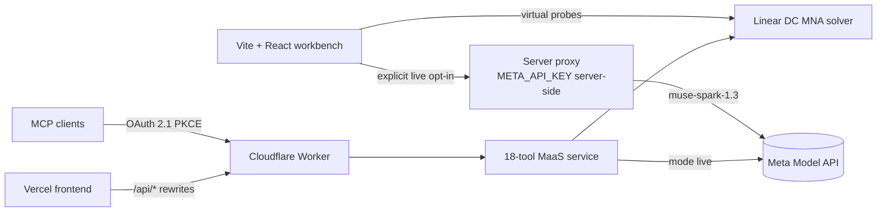

# TraceForge — Autonomous Virtual Circuit Diagnostic Laboratory


## A. Product Identity

TraceForge is a **hardware-free virtual circuit diagnostic laboratory**:
an interactive workbench where engineers practice real diagnostic
reasoning — probing rails, interpreting measurements against datasheet
specs, forming evidence-backed fault hypotheses — on three reference
boards simulated by a deterministic Linear DC engine. No bench, no
parts, no risk: every fault is reproducible, every measurement is
explained, and every diagnosis is scored objectively against withheld
ground truth.

**Engineering problem solved.** Hardware debugging skill is expensive to
build: real faults are irreproducible, probing live boards risks damage,
and datasheet reasoning is rarely practiced end-to-end. TraceForge
closes that gap with a virtual bench (deterministic MNA solver, hidden
fault injection, virtual multimeter), a real AI diagnostician option
(live Muse Spark 1.3 multi-turn tool calling through a server-side
proxy), and an objective scorer — so each session produces a measured
diagnosis score, not a vague impression.

**Core capabilities.**

- Interactive PCB visualization with progressive probe playback and
  live-AI measurement highlights (`src/components/PcbCanvas.tsx`).
- Deterministic Linear DC MNA virtual bench with node voltage, branch
  current, and unpowered continuity/resistance (`src/lib/circuit-simulator.ts`).
- Reproducible hidden fault injection across 3 boards × 3 faults, with
  ground truth strictly withheld until scoring.
- Guided 3-step UX (choose → investigate → review) plus recorded
  investigation replay at zero cost.
- Real Muse Spark 1.3 (`muse-spark-1.3`) multi-turn diagnostic reasoning
  with structured tool calls — always behind an explicit, paid opt-in.
- 18-tool MaaS/MCP server, Cloudflare Worker staging backend with
  OAuth 2.1 PKCE, and AES-256-GCM authenticated session tokens.
- Floating TraceForge Assistant: RAG-first answers from a versioned
  knowledge base (`KB_VERSION`) at `$0.00`, with explicitly authorized,
  budget-gated live inference only as a fallback.
- Explicit AI transparency badges on every result: `SIMULATED`,
  `STATIC_FIXTURE`, `RECORDED_LIVE_REPLAY`, `UNVERIFIED`,
  `UNAVAILABLE`, `LIVE_API`.

## B. Visual Overview

Screenshots live in `docs/assets/` (see
[the capture guide](docs/assets/CAPTURE_GUIDE.md)):


*Main laboratory interface & circuit selection (Step 1).*


*Active progressive PCB probing & virtual measurements (Step 2).*


*Completed diagnosis, ground-truth evaluation & rework guidance (Step 3).*


*Mobile responsive layout.*

## C. How TraceForge Works

The complete 10-step diagnostic workflow:

1. **Select a circuit (Step 1).** Pick one of the three reference
   boards; each card shows its symptom and a virtual-testing badge.
2. **Hidden fault injection.** The virtual lab injects one reproducible
   `HiddenFault` (or a nominal healthy session). Fault identity, target
   component, and faulted values are sealed inside the session.
3. **Probe the MNA bench (Step 2).** Measure node voltages, branch
   currents, and unpowered continuity/resistance through probe aliases
   (e.g. `TP_NRST`). Each probe consumes budget (`MAX_TOOL_CALLS = 8`).
4. **Compare against datasheet specs.** Every voltage reading is checked
   against its nominal spec and tolerance; abnormal readings are
   flagged, never asserted as root cause.
5. **Muse Spark 1.3 reasons.** In Virtual Lab mode the deterministic
   agent runs locally (`$0.00`); with an explicit `mode: "live"` opt-in,
   the real `muse-spark-1.3` model drives up to 8 bounded tool calls
   through the server proxy.
6. **Hypotheses form.** Candidate causes cite pinout lookups, rail
   checks, and continuity evidence — model-generated hypotheses stay
   visually distinct from verified faults.
7. **Ground-truth reveal (Step 3).** `traceforge.evaluation.score`
   discloses the withheld fault to the owning actor only, then locks the
   scenario against further probing.
8. **Objective scoring (`scoreDiagnosis`).** Component match, fault-type
   match, evidence confirmation, and probe efficiency combine into a
   0–100 score with a written summary.
9. **Rework guidance.** Confirmed faults unlock step-by-step rework
   instructions; unconfirmed hypotheses withhold them honestly.
10. **Verification receipts.** Every mutating tool call returns a
    SHA-256 verification receipt binding the capability, outcome, and
    correlation id for audit.

## D. Supported Reference Circuits

All three boards are simulated by the Linear DC MNA solver
(`src/lib/circuit-simulator.ts`) and documented in
`src/data/samples.ts`.

### 1. FPV Drone Flight Controller (`f405-flight-controller`)

STM32F405RGT6 flight controller. Nodes: `GND`, `LDO_OUT`, `U1-14`,
`U1-15`. Probe aliases: `TP_3V3 → U1-14`, `TP_NRST → U1-15`. Nominal
specs: `U1-14 = 3.267 V`, `U1-15 = 3.240 V` (±5%).

| Fault id | Target | What it models |
|---|---|---|
| `f405-nrst-gnd-short` | NRST net | Solder bridge/short pulling NRST to ground |
| `f405-pullup-open` | Pull-up | Open NRST pull-up resistor |
| `f405-pullup-drift` | Pull-up | Pull-up resistance drifted out of spec |

### 2. ESP32-S3 IoT Sensor Node (`esp32s3-sensor-node`)

ESP32-S3-WROOM-1 sensor node. Nodes: `GND`, `VUSB`, `TP_5V`,
`U2-OUT`. Probe alias: `C4-POS → TP_5V`. Nominal specs:
`TP_5V = 4.956 V`, `U2-OUT = 3.304 V` (±5%).

| Fault id | Target | What it models |
|---|---|---|
| `esp32-c4-rev-leak` | C4 | Reversed-leaky bulk capacitor dragging the rail |
| `esp32-f1-blown` | F1 | Blown input fuse starving the 5 V rail |
| `esp32-div-drift` | Divider | Sense-divider drift corrupting the 3V3 sense |

### 3. USB-C Power Delivery Trigger (`usbc-pd-trigger`)

CH224K PD trigger. Nodes: `GND`, `V5`, `CC1`, `CC2`. Probe aliases:
`TP_CC1 → CC1`, `TP_CC2 → CC2`. Nominal specs: `CC1 = 0.417 V`,
`CC2 = 0.417 V` (±10%, healthy CC2 is the built-in control channel).

| Fault id | Target | What it models |
|---|---|---|
| `usbc-d2-shorted` | D2 | TVS diode D2 failed short (EOS), clamping CC1 to ground |
| `usbc-cc1-pu-open` | R_PU1 | Open CC1 pull-up; Rd holds CC1 at 0 V |
| `usbc-rd-drift` | R_RD1 | CC1 Rd drifted high (5.1 kΩ → 47 kΩ) |

## E. Technical Architecture

- **Frontend:** Vite + React + TypeScript workbench (`src/App.tsx`,
  `src/components/`).
- **Virtual bench:** Linear DC MNA solver
  (`src/lib/circuit-simulator.ts`).
- **Diagnostic agent:** bounded multi-turn loop
  (`src/lib/diagnostic-agent.ts`, `MAX_TOOL_CALLS = 8`).
- **Meta client:** live/simulated Muse Spark 1.3 + SAM transparency
  (`src/lib/meta-client.ts`).
- **Local proxy:** same-origin server proxy attaching `META_API_KEY`
  (`src/server/meta-proxy.ts`).
- **MaaS service:** 18-tool MCP service (`src/maas/tools.ts`) with
  security layer (`src/maas/security.ts`), protocol
  (`src/maas/protocol.ts`), and verification receipts
  (`src/maas/verification.ts`).
- **Cloudflare Worker:** staging backend with OAuth 2.1 PKCE,
  AES-256-GCM tokens, awaited Edge Cache scenario synchronization with
  a Free-tier SQLite Durable Object coordinator (`TraceForgeStateDO`,
  backing `PersistedScenarioState` on `*.workers.dev`), and
  a server-authorized telemetry endpoint (`GET /api/maas/telemetry`)
  (`worker/index.ts`, `wrangler.toml`).
- **Deployment:** Vercel Hobby frontend with edge rewrites to the
  Worker (`vercel.json`).
- **Assistant:** floating widget (`src/components/TraceForgeAssistant.tsx`),
  versioned knowledge base (`src/data/knowledge-base.ts`,
  `docs/knowledge/traceforge-knowledge-base.md`), deterministic RAG
  engine (`src/lib/rag-engine.ts`), and gated server chat endpoints
  (`src/lib/assistant-server.ts`, `POST /api/assistant/chat`).



## F. AI Execution Modes

| Mode | User-Facing Badge | Internal Enum | Meaning |
|---|---|---|---|
| Virtual Lab | `Virtual Lab` | `SIMULATED` / `STATIC_FIXTURE` | Deterministic MNA bench + local agent. Default, `$0.00`. |
| Recorded Investigation | `Recorded Investigation` | `RECORDED_LIVE_REPLAY` | Zero-cost replay of a recorded live session. Never labeled live. |
| Live AI Ready | `Live AI Ready` | `UNVERIFIED` (proxy configured, idle) | Live mode selected and server proxy reachable; awaiting investigation start. |
| Live AI Investigating | `Live AI Investigating` | `UNVERIFIED` / `LIVE_API` (`running: true`) | Active multi-turn live `muse-spark-1.3` investigation in progress. |
| Completed with Muse Spark 1.3 | `Completed with Muse Spark 1.3` | `LIVE_API` (`running: false`) | Verified execution through the real remote `muse-spark-1.3` model. |
| Live AI Unavailable | `Live AI Unavailable` | `UNAVAILABLE` / proxy error | Required service, proxy, or live API credential is inaccessible. |

Explicit spend control: an omitted `mode` in
`traceforge.investigations.start` **always** runs simulated, even with a
live client attached. Read-only tools never invoke paid inference.

The Header, Step 2 header, and Step 3 results card share the same
unified status badge (`Virtual Lab`, `Recorded Investigation`,
`Live AI Ready`, `Live AI Investigating`,
`Completed with Muse Spark 1.3`, or `Live AI Unavailable`) so the
active execution state is consistent everywhere. Developer telemetry
(credit balances, token counts, cost math, raw enum codes) is removed
from the ordinary UI; technical diagnostics stay available only through
server-authorized access (`GET /api/maas/telemetry` with
`traceforge:audit:read`, alongside `traceforge.budget.status` and the
scoped `/api/maas/audit`).

## G. Installation & Local Development

```sh
npm install
npm run dev      # workbench, default http://localhost:5173
npm test         # full Vitest suite (simulated fixture mode, no keys needed)
npm run build    # TypeScript check + production bundle
npm run preview  # serve the production bundle
```

**Server-only key setup (never in the browser bundle).** Copy
`.env.example` to `.env` and set `META_API_KEY` there (or export it in
the server environment). The Vite middleware and the Cloudflare Worker
attach it server-side; no `VITE_*` variable ever carries it.

**Zero-cost testing.** Without a key, everything runs deterministically:
the MNA bench, the simulated agent, recorded replays, the full test
suite, and the production build — all at `$0.00`.

## H. MCP Integration

Staging endpoint: `https://traceforge-mcp-staging.apd1034.workers.dev/mcp`
(MCP 2025-06-18 JSON-RPC). Public tools need no token; all other tools
need a `Bearer` token with the listed scope. Only
`traceforge.investigations.start` with explicit `mode: "live"` can
consume paid inference credits — every other tool is non-billable.

| Tool | Purpose | Key args | Auth scope |
|---|---|---|---|
| `traceforge.capabilities.list` | List all 18 tools + schemas | — | public |
| `traceforge.system.status` | Health, solver, kill switch, sessions | — | public |
| `traceforge.models.status` | Spark/SAM modes, never calls paid inference | — | public |
| `traceforge.budget.status` | Budget baseline, ledger, safety stop | — | public |
| `traceforge.circuits.list` | 3 boards, symptoms, test points | — | public |
| `traceforge.circuits.get` | Ground-truth-free board view + probe points | `boardId` | public |
| `traceforge.scenarios.list` | Selectors + caller's own sessions | `boardId?` | `scenarios:read` |
| `traceforge.scenarios.create` | Isolated session + receipt (mutates) | `boardId`, `faultSelector?` | `scenarios:write` |
| `traceforge.measurements.voltage` | DC volts at node (mutates budget) | `scenarioId`, `node`, `refNode?` | `measurements:execute` |
| `traceforge.measurements.current` | DC amps via component (mutates budget) | `scenarioId`, `componentId` | `measurements:execute` |
| `traceforge.measurements.continuity` | Unpowered Ω between probes (mutates budget) | `scenarioId`, `probeA`, `probeB` | `measurements:execute` |
| `traceforge.measurements.history` | Probe log + PCB highlights | `scenarioId` | `measurements:read` |
| `traceforge.investigations.start` | Agentic diagnosis (mutates; **only paid path**) | `scenarioId?`, `boardId?`, `mode?` | `investigations:execute` |
| `traceforge.investigations.status` | Status, mode, turns, probes | `investigationId?`, `scenarioId?` | `investigations:read` |
| `traceforge.investigations.history` | Steps, probe log, highlights | `investigationId?`, `scenarioId?` | `investigations:read` |
| `traceforge.investigations.result` | Diagnosis + evidence, truth withheld | `investigationId?`, `scenarioId?` | `investigations:read` |
| `traceforge.evaluation.score` | Score vs hidden fault, discloses truth (mutates: locks) | `scenarioId`, `submission?` | `evaluation:score` |
| `traceforge.evaluation.report` | Full post-evaluation audit report | `scenarioId` | `evaluation:score` |

End-to-end JSON-RPC example (bearer abbreviated):

```json
{"jsonrpc": "2.0", "id": 1, "method": "tools/call",
 "params": {"name": "traceforge.scenarios.create",
  "arguments": {"boardId": "f405-flight-controller", "faultSelector": "random"}}}
{"jsonrpc": "2.0", "id": 2, "method": "tools/call",
 "params": {"name": "traceforge.measurements.voltage",
  "arguments": {"scenarioId": "scn_…", "node": "TP_NRST"}}}
{"jsonrpc": "2.0", "id": 3, "method": "tools/call",
 "params": {"name": "traceforge.investigations.start",
  "arguments": {"scenarioId": "scn_…"}}}
{"jsonrpc": "2.0", "id": 4, "method": "tools/call",
 "params": {"name": "traceforge.evaluation.score",
  "arguments": {"scenarioId": "scn_…"}}}
```

OAuth clients use RFC 7591 dynamic registration plus PKCE S256 and
OAuth 2.1 refresh-token rotation (`POST /oauth/register` →
`GET /oauth/authorize` → `POST /oauth/token` with
`grant_type=authorization_code` or `grant_type=refresh_token` →
`POST /oauth/revoke`); each issued token is bound to its own
`actor_oauth_<clientId>` actor with only its granted scopes, and
refresh-token state is persisted in `TraceForgeStateDO` so ChatGPT MCP
connections can renew expired 1-hour access tokens without full manual
re-authentication.

### H2. TraceForge Assistant (RAG-first, `$0.00` by default)

The floating **TraceForge Assistant** widget answers from a versioned
static knowledge base first (`src/data/knowledge-base.ts`,
`docs/knowledge/traceforge-knowledge-base.md`, pinned by `KB_VERSION =
'2026.10.27-v2'`, 18 topics): deterministic inverted-index + synonym +
BM25 retrieval with a confidence/coverage gate (`high`/`medium`/`low`),
prompt-injection refusal, greeting handling, and session-grounded
answers (board, symptom, probes, diagnosis, evaluated score breakdown)
with strict pre-evaluation ground-truth isolation.

Server flow (`POST /api/assistant/chat`, shared logic in
`src/lib/assistant-server.ts`, served by both `worker/index.ts` and
the local Vite middleware): RAG runs first; knowledge answers and
policy refusals return immediately (`mode: 'knowledge_base'`,
`liveInvoked: false`, zero Meta API calls). A paid `muse-spark-1.3`
call (at most 1 per message, `max_tokens: 350`, grounded system prompt)
happens only when the request opts in (`allowLiveInference: true`),
presents a valid `tf_chat_…` session ticket
(`GET|POST /api/assistant/session`) or a `Bearer` token with
`traceforge:live_inference:execute`, the server holds `META_API_KEY`,
and the shared-ledger reservation succeeds (`$2.00` chat allowance,
`$95.00` project safety stop, ≤10 calls/session, ≤2 concurrent,
per-client rate limit). Every other outcome — including upstream
errors, with no retries — returns a knowledge-only fallback
(`mode: 'knowledge_fallback'`, `liveInvoked: false`) at `$0.00`.

## I. Cloudflare Worker & Vercel Hobby ($0) Deployment

- **Staging Worker** (`traceforge-mcp-staging`, `worker/index.ts`):
  serves MCP, MaaS REST (`/api/maas/*`), server-authorized diagnostics
  (`GET /api/maas/telemetry`: `Bearer` + `traceforge:audit:read`,
  `401`/`403` otherwise), browser backend
  (`/api/meta/status`, `/api/meta/chat`, `/api/meta/segment`), health,
  and OAuth 2.1 discovery/revocation (`/.well-known/*`,
  `/oauth/register`, `/oauth/authorize`, `/oauth/token`,
  `/oauth/revoke`). Provision the key once with
  `wrangler secret put META_API_KEY` (optionally
  `TRACEFORGE_SESSION_SECRET` to key session tokens independently);
  the key never leaves the server.
- **Vercel Hobby frontend ($0/month, personal non-commercial
  hackathon demo):** Deployed at
  [`https://traceforge-ten.vercel.app`](https://traceforge-ten.vercel.app)
  (preview [`https://traceforge-kirn4r1qz-aigraphixs-projects.vercel.app`](https://traceforge-kirn4r1qz-aigraphixs-projects.vercel.app)).
  `vercel.json` rewrites `/api/meta/*`,
  `/api/maas/*`, `/api/assistant/*`, `/mcp`, and `/health` to the
  staging Worker origin, with `Cache-Control: no-cache, no-store,
  must-revalidate` on `/` and `/index.html` —
  no paid plans, trials, add-ons, domains, or usage billing.
- **Rollback:** redeploy the previous good build in Vercel, or
  `wrangler rollback` / redeploy the prior Worker version; both
  surfaces are stateless apart from Edge Cache (best-effort, same
  colocation — not a substitute for Durable Objects).
- **Cross-request sessions:** `scn_…` / `inv_…` ids are
  self-contained AES-256-GCM tokens, so any isolate holding the
  session secret can hydrate them. Every token uses a fresh random
  96-bit IV (`crypto.getRandomValues`, NIST SP 800-38D, explicit
  128-bit GCM tag, prefix bound as Additional Data) plus the full
  256-bit HMAC-SHA-256 Encrypt-then-MAC tag (`_…64 hex chars`),
  verified in constant time before decryption; AES and HMAC keys are
  derived via Web Crypto HKDF-SHA-256 with distinct domain labels.
  Every read merges the canonical
  `PersistedScenarioState` from Edge Cache (`probesUsed`, ordered
  probe log, canonical investigation, immutable scorecard) and every
  mutation awaits persistence first (`Cache-Control: max-age=1800`),
  so consecutive MCP calls agree even when routed across isolates.
  The canonical `investigationId` is reused from stored state when
  present and otherwise minted fresh then persisted, so cold isolates
  sharing durable/edge storage converge on one id. A
  per-actor Edge Cache index keeps `scenarios.list` consistent across
  isolates without leaking sessions between actors.
- **Strong global consistency on `*.workers.dev`
  (`TraceForgeStateDO`, `$0.00/month`):** `caches.default` is a
  no-op on `*.workers.dev` subdomains and MCP requests arrive from
  many egress IPs across PoPs/isolates — so the Worker routes every
  request through the canonical Free-tier SQLite Durable Object
  singleton (`traceforge-canonical-v1`, `wrangler.toml`
  `TRACEFORGE_STATE_DO` binding), whose transactional storage backs
  `PersistedScenarioState`, one-time OAuth authorization codes, and
  OAuth 2.1 refresh-token rotation/revocation records.

## J. Security

- **Server-side key isolation:** `META_API_KEY` is attached only by
  the local proxy and the Worker; browser bundles, responses, logs,
  and audit summaries never carry it (scrubbed + audited by tests).
- **OAuth 2.1 S256 PKCE + Refresh-Token Rotation:** per-client actor
  binding (`actor_oauth_<clientId>`), granted-scope enforcement,
  one-time refresh-token rotation (`grant_type=refresh_token`), replay
  rejection, scope preservation/narrowing (never escalation), and
  `POST /oauth/revoke` persisted in `TraceForgeStateDO`.
- **AES-256-GCM + HKDF + HMAC-SHA-256 tokens:** fresh random
  96-bit IV per token (IND-CPA semantic security, zero nonce reuse),
  explicit 128-bit GCM tag, prefix bound as Additional Data, full
  256-bit HMAC-SHA-256 Encrypt-then-MAC tag verified in constant time
  before decryption, HKDF-SHA-256 key derivation with distinct domain
  labels, and `rotateSessionSecret` / `rotateSigningSecret`
  rotation.
- **Tool scopes & tenant isolation:** every non-public capability
  requires its scope; scenarios/investigations are strictly
  per-actor (`MAAS_CROSS_TENANT_ACCESS_DENIED`).
- **Sliding-window rate limiting** (120 req/min default, per actor)
  and **hierarchical kill switch** (global > write-freeze > per-tool
  > per-token revocation with `MAAS_CREDENTIALS_REVOKED`).
- **Ground-truth isolation:** `assertGroundTruthIsolated` scans every
  pre-evaluation payload; truth reaches the owning actor only via
  `evaluation.score`.
- **Server-authorized diagnostics only:** `GET /api/maas/telemetry`
  requires `traceforge:audit:read`; the workbench UI shows a single
  mode badge and never renders balances, token counts, or cost math.
- **Budget safety stop:** live inference halts at `$95.00` of
  verified + runtime spend (see §K and `AGENTS.md` §8).

## K. Test Strategy

Run `npm test` (Vitest, simulated fixture mode — no keys, `$0.00`)
and `npm run build` (`tsc -b` + `vite build`, must report zero
errors). Coverage by area:

- **Unit:** electrical math, parser, samples, guided UX, stabilization.
- **MNA numerical verification:** solver matrices, all-3-board fault
  matrix end-to-end (website-vs-MCP voltage/current agreement).
- **MCP protocol & security:** schemas, auth, tenant isolation,
  rate limits, kill switch, AES-GCM token attacks (fresh-IV
  uniqueness, 1-bit modification, truncation, wrong-secret, prefix
  swap, rotation), OAuth per-client
  isolation, scope enforcement, revocation.
- **Spending control:** omitted-mode defaults to simulated, explicit
  live invokes the client, read-only status never calls inference,
  `$95.00` dual-measure safety stop, shared runtime ledger (including
  the `$2.00` assistant live allowance with per-session, concurrency,
  and rate-limit caps).
- **Assistant RAG-first routing:** all 18 knowledge topics plus
  `KB_VERSION` pinning, all 6 suggested questions answered locally
  (`liveInvoked: false`), greeting handling without citation clutter,
  session-grounded answers with pre-evaluation ground-truth
  isolation, prompt-injection refusal, and server chat gating (ticket
  / scope / kill switch / allowance / safety stop / input limits /
  single-call live path with usage ledger recording).
- **Cross-isolate consistency:** multi-isolate probe accumulation
  (`1→2→3` with ordered history), failed-probe budget preservation,
  one stable `investigationId` across isolates sharing durable/edge
  storage, one immutable
  scorecard across `score`/`report`, per-actor `scenarios.list`
  isolation, and `401`/`403`/`200` telemetry authorization.
- **Cloudflare Worker:** health/CORS, discovery metadata, PKCE
  exchange, replay protection, `/api/meta/*` routing (503 without
  key, 429 on safety stop), zero-Node-import guard.

What mocked tests do **not** establish: a green suite with stubbed
`fetch` proves protocol, math, isolation, and spend-guard behavior —
never that the external Meta Model API is reachable or billed. Only a
verified `LIVE_API` response (badge + `liveVerified: true` from a real
call) establishes live execution.

## L. Technical Limitations

- **Linear DC MNA only:** resistors, ideal sources, opens/shorts, and
  parameter drift. No nonlinear SPICE Newton-Raphson diode/transistor
  curves, no AC/transient (`C dV/dt`, `L dI/dt`).
- **No physical hardware attachment:** all measurements are virtual;
  nothing here drives a bench instrument.
- **SAM 3.1 live segmentation deferred:** overlays are
  `STATIC_FIXTURE` KiCad geometry by design (see §F, §M).
- **Edge Cache is per-colocation and best-effort:** cold isolates in
  other colos rehydrate from self-contained tokens; on
  `*.workers.dev` the `TraceForgeStateDO` SQLite Durable Object
  provides the strongly consistent global state instead (see §I).

## M. Project Status & Roadmap

**Implemented:** virtual bench + hidden faults for all 3 boards;
guided 3-step UX with progressive probing and recorded replay; live
Muse Spark 1.3 multi-turn tool calling (explicit opt-in); 18-tool
MaaS/MCP server; Cloudflare Worker with OAuth 2.1 PKCE, AES-256-GCM
tokens, and browser backend routes; Vercel Hobby deployment wiring;
budget ledger with `$95.00` safety stop; floating TraceForge Assistant
with versioned RAG knowledge base (`KB_VERSION`), deterministic local
retrieval, session-grounded answers, and explicitly authorized,
budget-gated live chat fallback; full simulated test suite.

**Deferred (not deleted where working):** live SAM 3.1 segmentation
(`STATIC_FIXTURE` overlays); multi-hundred-page PDF/datasheet
ingestion; full nonlinear/transient SPICE coverage; physical hardware
attachment; multi-user accounts, cloud databases, secondary AI models.

## N. Development & Contribution Governance

All work follows [`AGENTS.md`](AGENTS.md): Antigravity coordinates
(planning, review, QA, budget tracking) and never edits implementation
code; Muse Code is the exclusive implementation agent. Key standing
rules: `README.md` + `CHANGELOG.md` must be updated with every
functional change; simulated output is never presented as live
inference; `META_API_KEY` never enters browser bundles or commits;
TraceForge stays isolated from all other projects. The official
private repository is `danny121583/traceforge` (branch workflow,
no force-push, verify identity before remote operations).

## O. License & Usage

Proprietary — All Rights Reserved. No open-source `LICENSE` file is
granted with this repository; no license to copy, modify, or
redistribute is implied.

## P. Changelog

See [`CHANGELOG.md`](CHANGELOG.md) for milestones reconstructed from
Git history.
